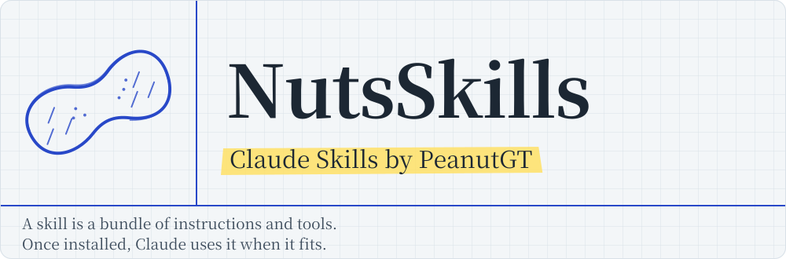

<h1 align="center">
  <picture>
    <source media="(prefers-color-scheme: dark)" srcset="docs/images/readme/header-en-dark.svg">
    
  </picture>
</h1>

<p align="center">
  <a href="LICENSE"></a>
  <a href="https://github.com/PeanutGT/NutsSkills/actions/workflows/validate.yml"></a>
  <a href="https://github.com/PeanutGT/NutsSkills/releases"></a>
</p>

<p align="center"><a href="README.md">繁體中文</a> | English</p>

## Skills

| Skill | Description | Version |
|---|---|---|
| [exam-prep](skills/exam-prep/) | Reorganizes slides, textbooks, photos of handwritten notes and past exams (uploaded or via Google Drive links) into beautifully laid-out PDFs: detailed handouts / concise notes, **exam pattern cards**, **Cornell recall notes**, **layered notes** (30 s / 5 min / full), with concept maps and statistics / linear-algebra figures. Also practice questions, separate answer keys and cheat sheets, with computed answers verified in code. Output is Traditional Chinese by default. | [Changelog](skills/exam-prep/CHANGELOG.md) |
| [music-studio](skills/music-studio/) | Generates instrumental music and BGM (seamless game loops, video scores, study/work background, personal tracks) locally on your NVIDIA GPU with ACE-Step 1.5. Customisable defaults, style library, description lexicon and workflows, plus a local dashboard. **(WIP)** | [Changelog](skills/music-studio/CHANGELOG.md) |

<p align="center">
  
  <br>
  <sub>exam-prep output: pattern cards, Cornell recall notes and layered notes, all generated from one photo of probability and statistics notes</sub>
</p>

## Install

### Claude.ai / Claude Desktop

1. Download the skill's zip (named `<skill-name>-<version>.zip`, e.g. `exam-prep-<version>.zip`) from [Releases](https://github.com/PeanutGT/NutsSkills/releases). **Don't unzip it.**
2. Make sure code execution is on: **Settings → Capabilities → "Code execution and file creation"** (on Team / Enterprise an owner enables it in organization settings).
3. Go to **[Customize → Skills](https://claude.ai/customize/skills)**, click **+ → Create skill → Upload a skill**, and choose the zip.
4. Check the skill is toggled on, then start a new chat.

> To update, download the new zip and upload it again to replace the old version.

### Claude Code

```text
/plugin marketplace add PeanutGT/NutsSkills
/plugin install exam-prep@nutsskills
```

Or copy it into a skills folder manually:

```bash
git clone https://github.com/PeanutGT/NutsSkills.git
cp -r NutsSkills/skills/exam-prep ~/.claude/skills/          # all projects
# or cp -r NutsSkills/skills/exam-prep <project>/.claude/skills/  # one project
```

## Usage

No special command is needed — just describe what you want, e.g.

> My linear algebra midterm is next Thursday. Here are the slides and past exams — make pattern cards and 12 practice questions.

Claude reads the materials first, asks about scope, organization style and theme, then produces the PDFs. See each skill's README for details and requirements.

## FAQ

**Upload fails?** Upload the zip from Releases as-is (its top level is the `exam-prep/` folder); don't unzip and re-zip it.

**Claude doesn't use the skill?** Check that it's toggled on under Customize → Skills and that code execution is enabled. You can also say "use the exam-prep skill".

**PDF generation fails?** The skill installs npm and pip packages and needs Chromium in the execution environment. Please paste the error Claude reports into an [issue](https://github.com/PeanutGT/NutsSkills/issues/new/choose).

## Feedback

- Something broke: [bug report](https://github.com/PeanutGT/NutsSkills/issues/new?template=bug_report.yml)
- Idea: [feature request](https://github.com/PeanutGT/NutsSkills/issues/new?template=feature_request.yml)
- Contributing code or a new skill: see [CONTRIBUTING.md](CONTRIBUTING.md)

⚠️ When reporting, **please don't upload copyrighted course materials or exams, or files containing personal information.** Describe the problem, or attach a screenshot of just the affected page.

## License

[Apache License 2.0](LICENSE) © 2026 PeanutGT. Free to use, modify and distribute (including commercially) as long as you keep the copyright and license notices and mark files you changed.
