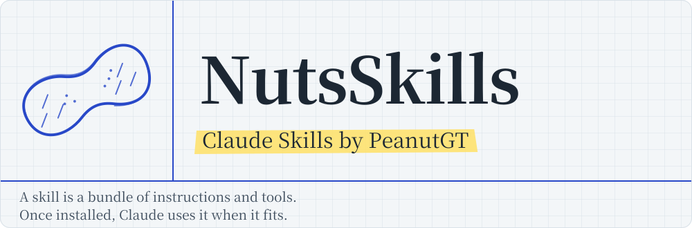
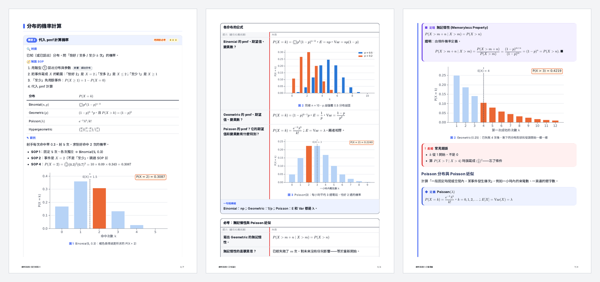

<h1 align="center">
  <picture>
    <source media="(prefers-color-scheme: dark)" srcset="docs/images/readme/header-en-dark.svg">
    
  </picture>
</h1>

<p align="center">
  <a href="LICENSE"></a>
  <a href="https://github.com/PeanutGT/NutsSkills/actions/workflows/validate.yml"></a>
  <a href="https://github.com/PeanutGT/NutsSkills/releases"></a>
</p>

<p align="center"><a href="README.md">繁體中文</a> | English</p>

## Skills

| Skill | Description | Version |
|---|---|---|
| [exam-prep](skills/exam-prep/) | Reorganizes slides, whole textbooks, photos of handwritten notes and past exams (uploaded or via Google Drive links) into beautifully laid-out PDFs: detailed handouts / concise notes, **exam pattern cards**, **Cornell recall notes**, **layered notes** (30 s / 5 min / full), with concept maps and statistics, linear-algebra and circuit diagrams. Also practice questions, separate answer keys and cheat sheets. Computed answers are verified in code, circuit questions are solved straight from the drawn schematic, and a whole textbook is read by its table of contents, chapter by chapter. Output is Traditional Chinese by default. | [](https://github.com/PeanutGT/NutsSkills/releases)<br>[Changelog](skills/exam-prep/CHANGELOG.md) |
| [music-studio](skills/music-studio/) | Generates instrumental music and BGM (seamless game loops, video scores, study/work background, personal tracks) locally on your NVIDIA GPU with ACE-Step 1.5. Pick or avoid instruments, get an automatic check for clipping, clicks and cut-off endings after every generation, and export with loudness presets for video, game or study use. Customisable defaults, style library, description lexicon and a local dashboard. | Installed with Claude Code, follows main (no zip)<br>[Changelog](skills/music-studio/CHANGELOG.md) |
| [nuts-engineering](skills/nutshell/) | A software-engineering workflow suite for coding agents (13 skills). The router [nutshell](skills/nutshell/) picks among [clarify](skills/clarify/), [spec](skills/spec/), [plan](skills/plan/), [tdd](skills/tdd/), [debug](skills/debug/), [verify](skills/verify/), [code-review](skills/code-review/), [design](skills/design/), [simplify](skills/simplify/), [ship](skills/ship/), [writing-skills](skills/writing-skills/): clarify → spec → plan → TDD → debug → verify before claiming done → review → ship. [repo-map](skills/repo-map/) builds a file/symbol/dependency map before reading code, 20–30x smaller than the source in our tests. Includes with/without-skill eval results. | Installed with Claude Code or Codex, follows main (no zip)<br>[Eval results](skills/nutshell/evals/RESULTS.md) |

<p align="center">
  
  <br>
  <sub>exam-prep output: pattern cards, Cornell recall notes and layered notes, all generated from one photo of probability and statistics notes</sub>
</p>

## Install

### Claude.ai / Claude Desktop

For exam-prep. music-studio needs the GPU in your own computer, and nuts-engineering is a multi-skill suite for coding, so install those with Claude Code or Codex below.

1. Download the skill's zip (named `<skill-name>-<version>.zip`, e.g. `exam-prep-<version>.zip`) from [Releases](https://github.com/PeanutGT/NutsSkills/releases). **Don't unzip it.**
2. Make sure code execution is on: **Settings → Capabilities → "Code execution and file creation"** (on Team / Enterprise an owner enables it in organization settings).
3. Go to **[Customize → Skills](https://claude.ai/customize/skills)**, click **+ → Create skill → Upload a skill**, and choose the zip.
4. Check the skill is toggled on, then start a new chat.

> To update, download the new zip and upload it again to replace the old version.

### Claude Code

```text
/plugin marketplace add PeanutGT/NutsSkills
/plugin install exam-prep@nutsskills
/plugin install music-studio@nutsskills   # needs an NVIDIA GPU
/plugin install nuts-engineering@nutsskills   # engineering workflow suite for coding
```

**Turn on auto-update** (recommended): Claude Code does not auto-update marketplaces you add yourself, so the plugin stays at the version you installed. Run `/plugin`, go to Marketplaces, pick `nutsskills` → "Enable auto-update", and Claude Code updates it every time it starts. Or add this to `~/.claude/settings.json`:

```json
{
  "extraKnownMarketplaces": {
    "nutsskills": {
      "source": { "source": "github", "repo": "PeanutGT/NutsSkills" },
      "autoUpdate": true
    }
  }
}
```

Without auto-update, update by hand: `claude plugin marketplace update nutsskills`, then `claude plugin update exam-prep@nutsskills`, and restart Claude Code.

Or copy it into a skills folder manually (no auto-update: `git pull` and copy again to update):

```bash
git clone https://github.com/PeanutGT/NutsSkills.git
cp -r NutsSkills/skills/exam-prep ~/.claude/skills/          # all projects
# or cp -r NutsSkills/skills/exam-prep <project>/.claude/skills/  # one project
```

### OpenAI Codex

```bash
codex plugin marketplace add PeanutGT/NutsSkills
codex plugin install exam-prep@nutsskills
codex plugin install nuts-engineering@nutsskills
```

Or copy it into a skills folder manually:

```bash
git clone https://github.com/PeanutGT/NutsSkills.git
cp -r NutsSkills/skills/exam-prep ~/.codex/skills/           # all projects (Windows: %USERPROFILE%\.codex\skills\)
# or cp -r NutsSkills/skills/exam-prep <project>/.agents/skills/  # one project only
```

Codex's default sandbox has no network and can't write outside the project folder, so exam-prep can't install its packages on first render. Run `python ~/.codex/skills/exam-prep/scripts/setup.py` once in a normal terminal; if you installed it as a plugin, ask Codex to "set up the exam-prep environment" and approve running it outside the sandbox. Then type `$exam-prep` or just describe what you need.

## Usage

No special command is needed — just describe what you want, e.g.

> My linear algebra midterm is next Thursday. Here are the slides and past exams — make pattern cards and 12 practice questions.

> Make a 60-second, seamlessly looping pixel-art game BGM.

exam-prep reads the materials first (for a whole textbook, its table of contents, then asks which chapters), asks about scope, organization style and theme, then produces the PDFs. See each skill's README for details and requirements.

## FAQ

**Upload fails?** Upload the zip from Releases as-is (its top level is the `exam-prep/` folder); don't unzip and re-zip it.

**Claude doesn't use the skill?** Check that it's toggled on under Customize → Skills and that code execution is enabled. You can also say "use the exam-prep skill".

**PDF generation fails?** The skill installs npm and pip packages and needs Chromium in the execution environment. On your own computer, ask Claude to run `scripts/setup.py --check` to see what's missing and `scripts/setup.py` to install it. If it still fails, please paste the error Claude reports into an [issue](https://github.com/PeanutGT/NutsSkills/issues/new/choose).

## Feedback

- Something broke: [bug report](https://github.com/PeanutGT/NutsSkills/issues/new?template=bug_report.yml)
- Idea: [feature request](https://github.com/PeanutGT/NutsSkills/issues/new?template=feature_request.yml)
- Contributing code or a new skill: see [CONTRIBUTING.md](CONTRIBUTING.md)

⚠️ When reporting, **please don't upload copyrighted course materials or exams, or files containing personal information.** Describe the problem, or attach a screenshot of just the affected page.

## License

[Apache License 2.0](LICENSE) © 2026 PeanutGT. Free to use, modify and distribute (including commercially) as long as you keep the copyright and license notices and mark files you changed.
