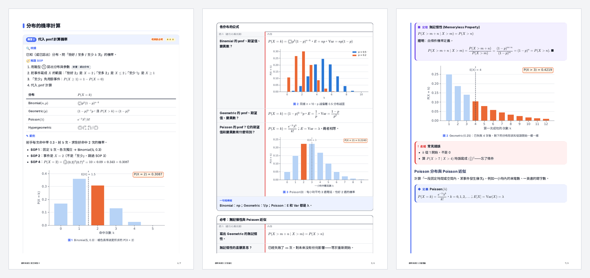

<h1 align="center">
  <picture>
    <source media="(prefers-color-scheme: dark)" srcset="docs/images/readme/header-zh-dark.svg">
    
  </picture>
</h1>

<p align="center">
  <a href="LICENSE"></a>
  <a href="https://github.com/PeanutGT/NutsSkills/actions/workflows/validate.yml"></a>
  <a href="https://github.com/PeanutGT/NutsSkills/releases"></a>
</p>

<p align="center">繁體中文 | <a href="README.en.md">English</a></p>

## Skills

| Skill | 說明 | 版本 |
|---|---|---|
| [exam-prep](skills/exam-prep/) | 把講義、投影片、整本課本、手寫筆記照片、考古題（可直接上傳或給 Google Drive 連結）重新組織成排版精美的 PDF：章節講義／重點、**題型解題卡**、**Cornell 回憶筆記**、**分層講義**，附概念地圖與統計、線代、電路圖；另可出練習題、獨立解答本、公式小抄。計算答案用程式驗算，電路題直接從畫出來的電路圖求解；整本課本先看目錄、只讀選定的章節 | [](https://github.com/PeanutGT/NutsSkills/releases)<br>[更新紀錄](skills/exam-prep/CHANGELOG.md) |
| [music-studio](skills/music-studio/) | 在你的 NVIDIA 顯卡上用 ACE-Step 1.5 本機生成純音樂／配樂（遊戲無縫循環、影片配樂、讀書工作背景音、個人創作）：可指定或避開樂器，每次生成後自動檢查爆音、咔噠聲、截斷，匯出時套用影片／遊戲／讀書的響度預設；附可自訂的預設值、風格庫、中文描述詞庫與本機儀表板 | 用 Claude Code 安裝，跟著 main 更新（不發 zip）<br>[更新紀錄](skills/music-studio/CHANGELOG.md) |
| [nuts-engineering](skills/nutshell/) | 寫程式用的軟體工程流程套組（13 個 skill）：路由 [nutshell](skills/nutshell/) 依情境挑選 [clarify](skills/clarify/)、[spec](skills/spec/)、[plan](skills/plan/)、[tdd](skills/tdd/)、[debug](skills/debug/)、[verify](skills/verify/)、[code-review](skills/code-review/)、[design](skills/design/)、[simplify](skills/simplify/)、[ship](skills/ship/)、[writing-skills](skills/writing-skills/)，涵蓋釐清需求 → 規格 → 拆任務 → TDD → 除錯 → 完成前驗證 → review → 出貨；[repo-map](skills/repo-map/) 產生檔案／符號／依賴地圖（大小約原始碼的 1/20–1/30），`--find` 直接列出某個函式在哪些行被使用。附有／無 skill 對照的評測結果 | 用 Claude Code 或 Codex 安裝，跟著 main 更新（不發 zip）<br>[評測結果](skills/nutshell/evals/RESULTS.md) |

<p align="center">
  
  <br>
  <sub>exam-prep 的產出：題型解題卡、Cornell 回憶筆記、分層講義（同一份機統筆記照片產出）</sub>
</p>

## 安裝

### Claude.ai／Claude 桌面版

適用 exam-prep。music-studio 要用你電腦上的顯卡、nuts-engineering 是寫程式用的多個 skill 套組，請用下面的 Claude Code 或 Codex 安裝。

1. 到 [Releases](https://github.com/PeanutGT/NutsSkills/releases) 下載要用的 skill 的 zip（檔名是 `<skill 名稱>-<版本>.zip`，例如 `exam-prep-<版本>.zip`），**不用解壓縮**
2. 確認已開啟程式碼執行：**Settings → Capabilities →「Code execution and file creation」**（Team／Enterprise 需由管理員在組織設定開啟）
3. 前往 **[Customize → Skills](https://claude.ai/customize/skills)**，按 **＋ → Create skill → Upload a skill**，選擇剛下載的 zip
4. 在清單中確認 skill 已開啟，開一個新對話即可使用

> 更新版本時，下載新的 zip 重新上傳，取代舊版即可。

### Claude Code

```text
/plugin marketplace add PeanutGT/NutsSkills
/plugin install exam-prep@nutsskills
/plugin install music-studio@nutsskills   # 需要 NVIDIA 顯卡
/plugin install nuts-engineering@nutsskills   # 寫程式用的工程流程套組
```

**開啟自動更新**（建議）：Claude Code 對自己加入的市集預設不自動更新，裝好後會一直停在安裝當下的版本。輸入 `/plugin`，到 Marketplaces 選 `nutsskills` →「Enable auto-update」，之後每次啟動 Claude Code 都會更新到最新版。也可以直接在 `~/.claude/settings.json` 加上：

```json
{
  "extraKnownMarketplaces": {
    "nutsskills": {
      "source": { "source": "github", "repo": "PeanutGT/NutsSkills" },
      "autoUpdate": true
    }
  }
}
```

不開自動更新時，手動更新：`claude plugin marketplace update nutsskills`，再 `claude plugin update exam-prep@nutsskills`，重開 Claude Code 生效。

或手動複製到 skills 資料夾（不會自動更新，要更新就重新 `git pull` 再複製）：

```bash
git clone https://github.com/PeanutGT/NutsSkills.git
cp -r NutsSkills/skills/exam-prep ~/.claude/skills/          # 所有專案可用
# 或 cp -r NutsSkills/skills/exam-prep <專案>/.claude/skills/  # 只給單一專案
```

### OpenAI Codex

```bash
codex plugin marketplace add PeanutGT/NutsSkills
codex plugin install exam-prep@nutsskills
codex plugin install nuts-engineering@nutsskills
```

或手動複製到 skills 資料夾：

```bash
git clone https://github.com/PeanutGT/NutsSkills.git
cp -r NutsSkills/skills/exam-prep ~/.codex/skills/           # 所有專案可用（Windows：%USERPROFILE%\.codex\skills\）
# 或 cp -r NutsSkills/skills/exam-prep <專案>/.agents/skills/  # 只給單一專案
```

Codex 預設的沙箱不能連網，也不能寫入專案資料夾以外的地方，exam-prep 第一次渲染時沒辦法自動安裝套件。請先在一般終端機執行一次 `python ~/.codex/skills/exam-prep/scripts/setup.py`；用 plugin 安裝的話，在 Codex 裡說「幫我安裝 exam-prep 的執行環境」，再核准它在沙箱外執行。之後輸入 `$exam-prep` 或直接描述需求即可使用。

## 使用

安裝後不需要特別呼叫，直接描述你要做的事，例如：

> 下週四期中考，附上講義和考古題，幫我做題型解題卡、出 12 題練習題

> 做一首 60 秒、可以無縫循環的像素風遊戲 BGM

> 這個測試在 CI 上會隨機失敗，幫我查原因

exam-prep 會先讀完資料（整本課本則先讀目錄、問你要哪幾章），再詢問範圍、整理方式、主題等細節，然後產出 PDF。各 skill 的用法與需求見各自資料夾內的 README。

## 常見問題

**上傳時出現錯誤？**
確認上傳的是 Releases 下載的 zip 原檔（裡面第一層是 `exam-prep/` 資料夾），不要自己解壓縮後重新壓縮。

**Claude 沒有使用 skill？**
確認 skill 在 Customize → Skills 中是開啟的，且已開啟程式碼執行；也可以在訊息中直接說「用 exam-prep skill」。

**產生 PDF 時失敗？**
Skill 需要在執行環境中安裝 npm 與 pip 套件，以及 Chromium。在自己的電腦上可以請 Claude 執行 `scripts/setup.py --check` 看缺什麼、`scripts/setup.py` 一次裝好。還是不行，請把 Claude 回報的錯誤訊息貼到 [Issue](https://github.com/PeanutGT/NutsSkills/issues/new/choose)。

## 回報問題與建議

- 遇到錯誤：[回報 Bug](https://github.com/PeanutGT/NutsSkills/issues/new?template=bug_report.yml)
- 想要新功能：[功能建議](https://github.com/PeanutGT/NutsSkills/issues/new?template=feature_request.yml)
- 想貢獻程式碼或新 skill：見 [CONTRIBUTING.md](CONTRIBUTING.md)

⚠️ 回報問題時，**請不要上傳有版權的課程講義、考卷，或含有個人資料的檔案**。用文字描述，或只附產出 PDF 中出問題那一頁的截圖。

## Repo 結構

```
NutsSkills/
├── skills/<skill-name>/         # 每個 skill 一個資料夾，SKILL.md 是本體
│   ├── SKILL.md
│   ├── CHANGELOG.md
│   ├── README.md / README.en.md
│   ├── scripts/ references/ assets/
│   └── evals/                   # 測試案例（不會打包進 zip）
├── .claude-plugin/marketplace.json   # plugin marketplace（Claude Code、Codex 都讀這份）
├── tools/                       # 驗證與打包腳本
└── .github/                     # CI、Issue 範本
```

## 授權

[Apache License 2.0](LICENSE) © 2026 PeanutGT。可以自由使用、修改、散布（包含商業用途），但須保留版權與授權聲明，並註明修改過的檔案。
