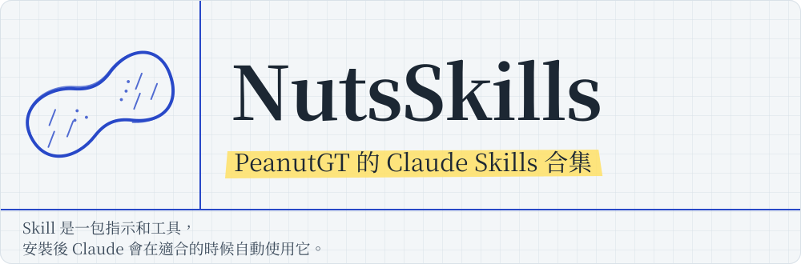

<h1 align="center">
  <picture>
    <source media="(prefers-color-scheme: dark)" srcset="docs/images/readme/header-zh-dark.svg">
    
  </picture>
</h1>

<p align="center">
  <a href="LICENSE"></a>
  <a href="https://github.com/PeanutGT/NutsSkills/actions/workflows/validate.yml"></a>
  <a href="https://github.com/PeanutGT/NutsSkills/releases"></a>
</p>

<p align="center">繁體中文 | <a href="README.en.md">English</a></p>

## Skills

| Skill | 說明 | 版本 |
|---|---|---|
| [exam-prep](skills/exam-prep/) | 把講義、投影片、課本、手寫筆記照片、考古題（可直接上傳或給 Google Drive 連結）重新組織成排版精美的 PDF：章節講義／重點、**題型解題卡**、**Cornell 回憶筆記**、**分層講義**，附概念地圖與統計/線代圖表；另可出練習題、獨立解答本、公式小抄，計算答案用程式驗算 | [更新紀錄](skills/exam-prep/CHANGELOG.md) |
| [music-studio](skills/music-studio/) | 在你的 NVIDIA 顯卡上用 ACE-Step 1.5 本機生成純音樂／配樂（遊戲無縫循環、影片配樂、讀書工作背景音、個人創作），附可自訂的預設值、風格庫、中文描述詞庫、工作流程與本機儀表板 **(WIP)** | [更新紀錄](skills/music-studio/CHANGELOG.md) |

<p align="center">
  
  <br>
  <sub>exam-prep 的產出：題型解題卡、Cornell 回憶筆記、分層講義（同一份機統筆記照片產出）</sub>
</p>

## 安裝

### Claude.ai／Claude 桌面版

1. 到 [Releases](https://github.com/PeanutGT/NutsSkills/releases) 下載要用的 skill 的 zip（檔名是 `<skill 名稱>-<版本>.zip`，例如 `exam-prep-<版本>.zip`），**不用解壓縮**
2. 確認已開啟程式碼執行：**Settings → Capabilities →「Code execution and file creation」**（Team／Enterprise 需由管理員在組織設定開啟）
3. 前往 **[Customize → Skills](https://claude.ai/customize/skills)**，按 **＋ → Create skill → Upload a skill**，選擇剛下載的 zip
4. 在清單中確認 skill 已開啟，開一個新對話即可使用

> 更新版本時，下載新的 zip 重新上傳，取代舊版即可。

### Claude Code

```text
/plugin marketplace add PeanutGT/NutsSkills
/plugin install exam-prep@nutsskills
```

或手動複製到 skills 資料夾：

```bash
git clone https://github.com/PeanutGT/NutsSkills.git
cp -r NutsSkills/skills/exam-prep ~/.claude/skills/          # 所有專案可用
# 或 cp -r NutsSkills/skills/exam-prep <專案>/.claude/skills/  # 只給單一專案
```

## 使用

安裝後不需要特別呼叫，直接描述你要做的事，例如：

> 下週四期中考，附上講義和考古題，幫我做題型解題卡、出 12 題練習題

Claude 會先讀完資料，再詢問範圍、整理方式、主題等細節，然後產出 PDF。各 skill 的用法與需求見各自資料夾內的 README。

## 常見問題

**上傳時出現錯誤？**
確認上傳的是 Releases 下載的 zip 原檔（裡面第一層是 `exam-prep/` 資料夾），不要自己解壓縮後重新壓縮。

**Claude 沒有使用 skill？**
確認 skill 在 Customize → Skills 中是開啟的，且已開啟程式碼執行；也可以在訊息中直接說「用 exam-prep skill」。

**產生 PDF 時失敗？**
Skill 需要在執行環境中安裝 npm 與 pip 套件，以及 Chromium。請把 Claude 回報的錯誤訊息貼到 [Issue](https://github.com/PeanutGT/NutsSkills/issues/new/choose)。

## 回報問題與建議

- 遇到錯誤：[回報 Bug](https://github.com/PeanutGT/NutsSkills/issues/new?template=bug_report.yml)
- 想要新功能：[功能建議](https://github.com/PeanutGT/NutsSkills/issues/new?template=feature_request.yml)
- 想貢獻程式碼或新 skill：見 [CONTRIBUTING.md](CONTRIBUTING.md)

⚠️ 回報問題時，**請不要上傳有版權的課程講義、考卷，或含有個人資料的檔案**。用文字描述，或只附產出 PDF 中出問題那一頁的截圖。

## Repo 結構

```
NutsSkills/
├── skills/<skill-name>/         # 每個 skill 一個資料夾，SKILL.md 是本體
│   ├── SKILL.md
│   ├── CHANGELOG.md
│   ├── README.md / README.en.md
│   ├── scripts/ references/ assets/
│   └── evals/                   # 測試案例（不會打包進 zip）
├── .claude-plugin/marketplace.json   # Claude Code plugin marketplace
├── tools/                       # 驗證與打包腳本
└── .github/                     # CI、Issue 範本
```

## 授權

[Apache License 2.0](LICENSE) © 2026 PeanutGT。可以自由使用、修改、散布（包含商業用途），但須保留版權與授權聲明，並註明修改過的檔案。
