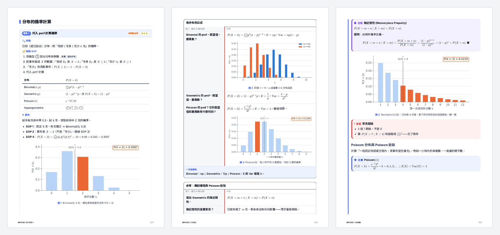
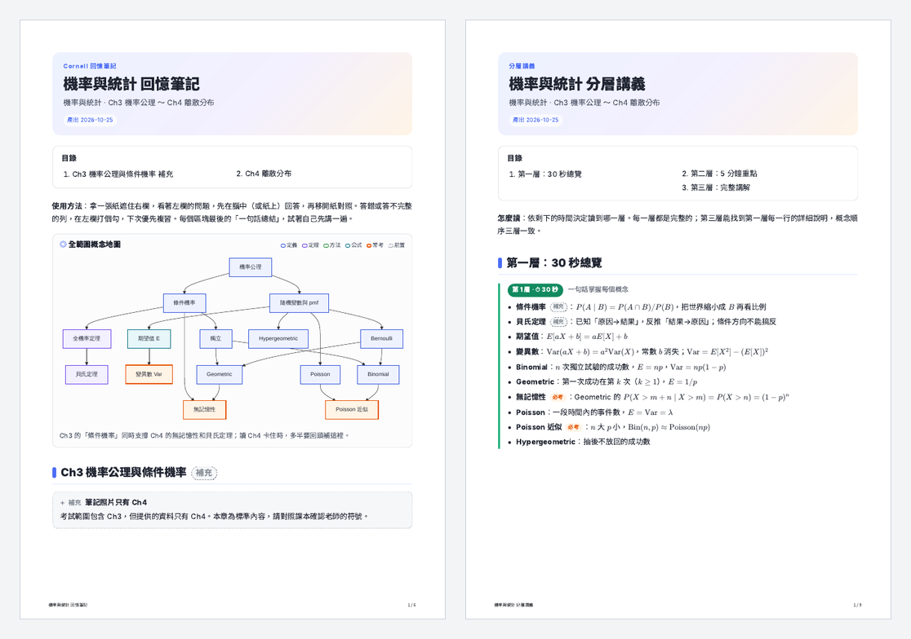

# exam-prep

繁體中文 | [English](README.en.md)

把學習資料整理成排版精美、可列印的 PDF，用來學懂教材或準備考試。

左起：題型解題卡、Cornell 回憶筆記、分層講義（同一份機統筆記照片產出）

## 特色

不是把教材照章節重寫一遍，而是**重新組織知識**：

1. **概念分析**：找出每個概念的前置依賴、出處、考古題出現次數與題型
2. **多種整理方式（可複選，每種一份 PDF）**

   | 整理方式 | 回答的問題 |
   |---|---|
   | 章節講義（詳盡） | 這個範圍到底在講什麼？ |
   | 章節重點（精簡） | 哪些東西要記？ |
   | 題型解題卡 | 考試會怎麼問、看到題目該怎麼解？（辨識特徵 → SOP → 範例 → 陷阱） |
   | Cornell 回憶筆記 | 我真的記得嗎？（遮住右欄自我測驗） |
   | 分層講義 | 只有 30 秒／5 分鐘／充足時間，各該讀什麼？ |

3. **概念地圖**：每份整理文件都有全範圍總圖與每章章節圖，標出依賴關係與常考概念
4. **圖表**：分布長條圖、機率面積、直方圖、盒鬚圖、迴歸、文氏圖、機率樹、線性變換……能畫圖的就畫圖
5. **驗算**：解答、例題、圖上的數字全部用 SymPy/SciPy 重算
6. **省 token**：原始資料只讀一次並整理成標好出處的 `materials.md`；只有公式、圖表、照片等文字抽不出來的頁面才看圖，而且多頁拼成一張低解析度總覽

另可產出練習題（中文／英文／中英對照可選）、與題目分開的解答本、雙欄公式小抄。三套主題：現代筆記風、教科書風、精簡小抄風。

## 支援的輸入

投影片 PDF／PPT、課本章節、手寫或手機拍的筆記照片、考古題、作業；可直接上傳，或給 Google Drive 檔案／資料夾連結（需連接 Google Drive）。

## 安裝

見 [repo 首頁的安裝說明](../../README.md#安裝)。Claude.ai 使用者到 [Releases](https://github.com/PeanutGT/NutsSkills/releases) 下載 `exam-prep-<版本>.zip` 上傳即可。

## 使用方式

安裝後直接對 Claude 說，例如：

- 「下週四線代期中考，附上講義和考古題，幫我整理重點、出 12 題練習題」
- 「這是機統的上課投影片，幫我整理成一份學習講義」
- 「後天考機統，幫我做題型解題卡跟 Cornell 回憶筆記」

Claude 會先讀完資料，再詢問範圍、要哪些文件、主題、題型與語言等，然後產出 PDF。

## 概念地圖

每份整理文件開頭都有全範圍概念地圖，每章開頭有章節地圖，標出前置依賴與常考概念：

## 執行需求

Claude.ai 上需要開啟**程式碼執行**（Settings → Capabilities）；skill 會在執行環境中自動安裝缺少的套件。在自己的電腦用 Claude Code 時需要：

- Node.js（渲染用；`katex`、`marked`、`playwright`、`mermaid` 缺少時會自動安裝到 `~/.exam-prep-deps`）
- Chromium（Playwright 使用）、Noto Sans/Serif CJK TC 字型
- Python 3 + `sympy`、`scipy`（驗算用）、`matplotlib`（圖表用）
- poppler（`pdftotext`、`pdfinfo`、`pdftoppm`，讀取 PDF 與排版檢查用）：Windows `scoop install poppler` 或 `conda install -c conda-forge poppler`；macOS `brew install poppler`；Linux `apt install poppler-utils`
- 選用：LibreOffice（PPTX 裡需要看圖的投影片轉圖片）、pandoc（DOCX 轉文字較完整）

`python scripts/setup.py --check` 檢查缺什麼，`python scripts/setup.py` 一次裝好 npm 套件、Chromium 與 Python 套件（poppler、Node.js 需自行安裝）。用 Codex 時請在沙箱外執行，見[安裝說明](../../README.md#openai-codex)。

## 檔案

- `SKILL.md` — skill 本體
- `scripts/ingest.py` — 讀取所有資料、挑出需要看圖的頁面
- `scripts/render.mjs` — Markdown → 主題化 PDF
- `scripts/setup.py` — 檢查與安裝執行環境
- `agents/openai.yaml` — Codex 介面顯示的名稱與簡介
- `scripts/preview.py` — PDF 縮圖總覽，檢查排版
- `scripts/figures.py` — 教學圖表
- `scripts/verify_helpers.py` — 驗算比較工具
- `assets/themes/` — 主題樣式
- `references/` — 撰寫語法、讀取資料、概念分析與地圖、圖表、出題指南、驗算流程；`references/styles/` 五種整理方式各自的寫法
- `evals/` — 測試案例（開發用，不會打包進 Releases 的 zip）
- `CHANGELOG.md` — 更新紀錄

## 已知限制

- 輸出以繁體中文為主（練習題可選英文或中英對照）
- 掃描品質差或字跡潦草的手寫筆記，辨識可能出錯；關鍵數值不確定時 Claude 會請你確認
- 證明題、申論題無法用程式驗算，會在解答標示「無法程式驗算」
- Google Drive 讀取需要先連接 Google Drive；產出的 PDF 不會自動存回 Drive
