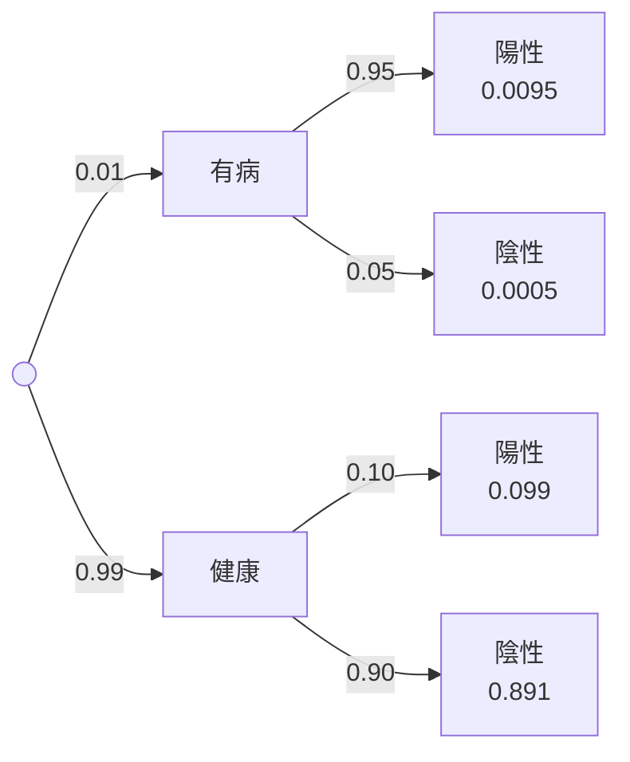

# 圖示指南

圖不是裝飾。一張好的教學圖，要讓讀者「看一眼就懂」一個用文字要講三段的事情。

## 什麼時候要畫圖

每個概念都問：**這個東西有形狀、有分布、有流程、有空間關係嗎？** 有就畫。

| 內容 | 該畫的圖 | 工具 |
|---|---|---|
| 概念之間的依賴 | 概念地圖 | Mermaid（`:::map`） |
| 解題流程、決策（選哪個檢定、能否對角化） | 流程圖／決策樹 | Mermaid `flowchart LR` |
| 多階段機率、條件機率 | 機率樹 | Mermaid `flowchart LR`，邊上標機率 |
| 時間順序、演算法步驟 | 流程圖 | Mermaid |
| 離散分布（Binomial、Poisson、Geometric…） | 機率質量長條圖，事件用顏色標出 | `figures.pmf_bar` |
| 連續分布、機率 = 面積 | 密度曲線＋陰影面積 | `figures.pdf_area` |
| 近似（Binomial ≈ Poisson、CLT）、參數比較 | 2–3 條並列 | `figures.compare_curves` |
| CDF | 階梯圖（開/閉端點） | `figures.cdf_step` |
| 樣本資料的分布 | 直方圖（可疊上理論密度） | `figures.histogram` |
| 四分位數、IQR、離群值 | 標註式盒鬚圖 | `figures.boxplot_annotated` |
| 相關、迴歸、殘差 | 散佈圖＋迴歸線（可畫殘差） | `figures.scatter_regression` |
| 事件關係、排容原理 | 文氏圖 | `figures.venn2` |
| 線性變換、特徵向量、基底 | 變換前後對照圖 | `figures.linear_map_2d` |
| 函數、極限、導數、積分 | 函數圖 | `figures.function_plot` |
| 其他 | 用 matplotlib 自己畫，但沿用 `figures.py` 的配色與 `_setup()` | — |

統計科目尤其要多用圖：每個分布至少一張圖，每個檢定的拒絕域用 `pdf_area` 畫出來，每個描述統計量（平均、中位數、IQR、標準差）都在圖上標出它在哪裡。

## 怎麼畫

```python
import sys; sys.path.insert(0, "<skill-dir>/scripts")
import figures as F
from scipy.stats import binom, norm

F.pmf_bar(range(11), [binom.pmf(k, 10, .3) for k in range(11)], "figs/binom.svg",
          highlight=lambda k: k <= 2, highlight_label="P(X ≤ 2)", mean=3, xlabel="命中次數 k")
F.pdf_area(norm.pdf, (-3.5, 3.5), "figs/z95.svg", shade=(-1.96, 1.96), shade_label="95%",
           marks={-1.96: "−1.96", 1.96: "1.96"}, xlabel="z", ylabel="φ(z)")
F.linear_map_2d([[2, 1], [1, 2]], "figs/eigen.svg", vectors={"v₁": (1, 1), "v₂": (1, -1)})
```

- 圖檔存在 Markdown 同一層的 `figs/` 資料夾，用相對路徑引用；渲染器會自動解析
- 所有函式都輸出 SVG（文字保持清晰）；各函式參數見 `scripts/figures.py` 的 docstring
- 需要 `matplotlib`、`numpy`，統計分布用 `scipy.stats`：`pip install --break-system-packages -q matplotlib scipy`

放進文件：

```markdown
:::fig Binomial(10, 0.3)：橘色長條的總和就是 P(X ≤ 2)

:::
```

- 圖會自動編號（圖 1、圖 2…），內文可寫「見圖 3」
- **圖說要說出重點**，不是只寫圖名：寫「橘色面積 = 95%，所以兩側各剩 2.5%」，而不是「標準常態分布」

Mermaid 機率樹範例：

````markdown

````

## 設計規則（已內建在 figures.py，自己畫圖時也要遵守）

- **顏色有固定角色**：藍 `#2a78d6` 是主要資料；橘 `#eb6834` 是「被強調的事件／對照組」；綠 `#1baf7a` 是第三組或特殊方向（例如特徵方向）。同一份文件中顏色意義保持一致
- **一張圖最多 3 組資料**；更多就拆成多張並排
- **只有一個 y 軸**；兩種單位不同的量畫成兩張圖
- 直接在線的末端標名稱，少用圖例框；文字用深灰，不用資料的顏色
- 格線淡、線條 2px、長條之間留白
- 圖上的數字要正確：圖中標的機率、平均、迴歸係數，同樣要寫進 `verify.py` 驗算

## 檢查

渲染後看每一張圖：標籤有沒有互相重疊、文字有沒有被裁掉、陰影區域是否就是題目問的事件、顏色意義是否和圖說一致。
