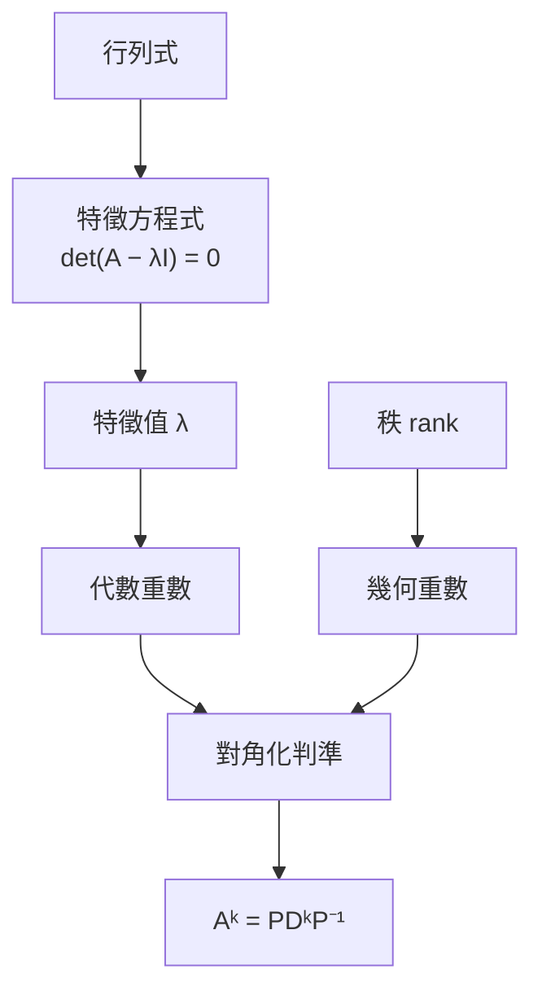

# 整理方式指南：共同基礎

這套 skill 的特色在於**重新組織知識**，而不是照教材順序重寫一遍。所有整理方式共用同一份概念分析（第 1 節）與概念地圖規格（第 2 節），所以同時產出多份時內容一致。各整理方式的寫法分在 `styles/`，**只讀這次要產出的那幾份**：

| 整理方式 | kind | 回答的問題 | 寫法 |
|---|---|---|---|
| 章節講義 | `handout` | 這個範圍到底在講什麼？（第一次學、沒聽懂） | `styles/handout.md` |
| 章節重點 | `notes` | 哪些東西要記？（考前回顧） | `styles/notes.md` |
| 題型解題卡 | `patterns` | 考試會怎麼問、我該怎麼解？ | `styles/patterns.md` |
| Cornell 回憶筆記 | `cornell` | 我真的記得嗎？ | `styles/cornell.md` |
| 分層講義 | `layered` | 我只有 X 分鐘，該讀什麼？ | `styles/layered.md` |

## 1. 概念分析（所有整理方式的共同基礎）

從 `materials.md`（見 `reading-inputs.md`）整理出一份 `concepts.md`（不交付，給自己用）；之後所有文件都只根據這兩份檔案寫，不再回頭讀原始 PDF 或圖片：

```markdown
| id | 概念 | 類型 | 前置 | 出處 | 考古題 | 題型 |
|---|---|---|---|---|---|---|
| EV | 特徵值 λ | def | CE | 投影片 p2 | 2024-1, 2025-1 | 求特徵值 |
| CE | 特徵方程式 | formula | DET | 投影片 p3 | 2024-1 | 求特徵值 |
| DC | 對角化判準 | thm | EV, GM, AM | 投影片 p4、課本 5.3 | 2024-2, 2025-2, 2025-4 | 判斷可否對角化 |
...
```

- **類型**：`def` 定義、`thm` 定理/性質、`formula` 公式、`method` 解題方法/演算法
- **前置**：理解這個概念之前必須先懂的概念 id。範圍外的前置（例如行列式）也列出，在地圖中用 `pre` 樣式畫
- **題型**：這個概念在考試中以什麼形式出現（題型解題卡的依據）

這份表決定：
- **講解順序**：每個概念都排在它所有前置之後（拓撲排序）。教材順序和依賴順序衝突時，以依賴順序為準，並在講義中說明「這裡先介紹 X，因為後面的 Y 需要它」
- **概念地圖**的節點與箭頭
- **前置徽章**：每個概念或題型卡標出 `{{前置: 秩、零空間}}`，讀者卡住時知道該回頭補什麼

## 2. 概念地圖（每份整理文件都要有）

每份整理文件（講義、重點、解題卡、Cornell、分層）都包含：
- **全範圍總圖**：文件第一個 `##` 章節之前，標題「全範圍概念地圖」，以章節或主題為單位（≤ 20 個節點）
- **每章章節圖**：每個 `##` 章開頭，畫該章的概念（≤ 15 個節點），範圍外的前置用 `:::pre`
- 題型解題卡的總圖改畫「題型 ← 概念」：每個題型節點連到它用到的概念，讀者一眼看出哪個概念支撐最多題型

語法（放在 `:::map` 容器內，渲染器自動加上圖例與配色）：

````markdown
:::map 第 5 章 概念地圖

讀不懂「對角化判準」？先確認：秩、零空間。
:::
````

規則：
- 節點類別：`def` `thm` `formula` `method` `pre`（範圍外前置）；常考的節點**另外**加一行 `ID:::hot`（會覆蓋成橘色粗框）
- 箭頭方向 = 「A 是 B 的前置」；可加邊標籤 `A -- 用來判斷 --> B`，只在關係不明顯時加
- **節點文字不能用 LaTeX**（Mermaid 不渲染 `$...$`）：用 Unicode，例如 λ、⁻¹、ᵏ、≤、∑、√、x̄、σ²；換行用 `<br/>`
- 方向：概念多、層級深用 `TD`；流程或決策用 `LR`
- 地圖下方可以加一句閱讀提示（例如卡在哪個節點該先補什麼）
- 渲染後檢查：節點文字沒有被截斷、圖沒有擠成一長條；太大就拆成兩張或減少節點

Mermaid 也適合畫**流程與決策**（解題 SOP、假設檢定選哪個檢定、機率樹），見 `figures.md`。

## 3. 圖示（所有整理方式都要用）

能用圖說明的，就不要只用文字。每個概念問自己：「這個東西有形狀嗎？」有的話就畫。圖表種類與用法見 `figures.md`。
