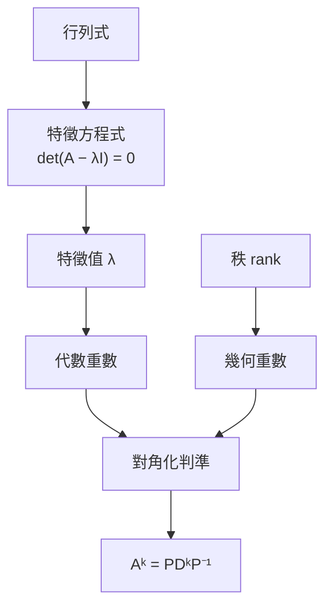

# 整理方式指南

這套 skill 的特色在於**重新組織知識**，而不是照教材順序重寫一遍。所有整理方式共用同一份「概念分析」（第 1 節），所以同時產出多份時內容一致、不互相矛盾。

| 整理方式 | kind | 回答的問題 | 適合 |
|---|---|---|---|
| 章節講義 | `handout` | 這個範圍到底在講什麼？ | 第一次學、上課沒聽懂 |
| 章節重點 | `notes` | 哪些東西要記？ | 學過了，考前回顧 |
| 題型解題卡 | `patterns` | 考試會怎麼問、我該怎麼解？ | 考前刷題、計算科目 |
| Cornell 回憶筆記 | `cornell` | 我真的記得嗎？ | 背誦多、觀念題多的科目 |
| 分層講義 | `layered` | 我只有 X 分鐘，該讀什麼？ | 時間不確定、想由淺入深 |

章節講義的寫法見 SKILL.md 3a，章節重點見 3b；本檔說明其他三種，以及所有方式共用的概念分析與概念地圖。

---

## 1. 概念分析（所有整理方式的共同基礎）

讀完資料後、寫任何文件前，先在工作目錄寫一份 `concepts.md`（不交付，給自己用）：

```markdown
| id | 概念 | 類型 | 前置 | 出處 | 考古題 | 題型 |
|---|---|---|---|---|---|---|
| EV | 特徵值 λ | def | CE | 投影片 p2 | 2024-1, 2025-1 | 求特徵值 |
| CE | 特徵方程式 | formula | DET | 投影片 p3 | 2024-1 | 求特徵值 |
| DC | 對角化判準 | thm | EV, GM, AM | 投影片 p4、課本 5.3 | 2024-2, 2025-2, 2025-4 | 判斷可否對角化 |
...
```

- **類型**：`def` 定義、`thm` 定理/性質、`formula` 公式、`method` 解題方法/演算法
- **前置**：理解這個概念之前必須先懂的概念 id。範圍外的前置（例如行列式）也列出，在地圖中用 `pre` 樣式畫
- **題型**：這個概念在考試中以什麼形式出現（題型解題卡的依據）

這份表決定：
- **講解順序**：每個概念都排在它所有前置之後（拓撲排序）。教材順序和依賴順序衝突時，以依賴順序為準，並在講義中說明「這裡先介紹 X，因為後面的 Y 需要它」
- **概念地圖**的節點與箭頭
- **前置徽章**：每個概念或題型卡標出 `{{前置: 秩、零空間}}`，讀者卡住時知道該回頭補什麼

## 2. 概念地圖（每份整理文件都要有）

每份整理文件（講義、重點、解題卡、Cornell、分層）都包含：
- **全範圍總圖**：文件第一個 `##` 章節之前，標題「全範圍概念地圖」，以章節或主題為單位（≤ 20 個節點）
- **每章章節圖**：每個 `##` 章開頭，畫該章的概念（≤ 15 個節點），範圍外的前置用 `:::pre`
- 題型解題卡的總圖改畫「題型 ← 概念」：每個題型節點連到它用到的概念，讀者一眼看出哪個概念支撐最多題型

語法（放在 `:::map` 容器內，渲染器自動加上圖例與配色）：

````markdown
:::map 第 5 章 概念地圖

讀不懂「對角化判準」？先確認：秩、零空間。
:::
````

規則：
- 節點類別：`def` `thm` `formula` `method` `pre`（範圍外前置）；常考的節點**另外**加一行 `ID:::hot`（會覆蓋成橘色粗框）
- 箭頭方向 = 「A 是 B 的前置」；可加邊標籤 `A -- 用來判斷 --> B`，只在關係不明顯時加
- **節點文字不能用 LaTeX**（Mermaid 不渲染 `$...$`）：用 Unicode，例如 λ、⁻¹、ᵏ、≤、∑、√、x̄、σ²；換行用 `<br/>`
- 方向：概念多、層級深用 `TD`；流程或決策用 `LR`
- 地圖下方可以加一句閱讀提示（例如卡在哪個節點該先補什麼）
- 渲染後檢查：節點文字沒有被截斷、圖沒有擠成一長條；太大就拆成兩張或減少節點

Mermaid 也適合畫**流程與決策**（解題 SOP、假設檢定選哪個檢定、機率樹），見 `figures.md`。

---

## 3. 題型解題卡（`kind: patterns`）

**核心想法**：考試不會照章節出題，而是照題型出題。解題卡把整個範圍改以「考試會怎麼問」重新組織，每種題型一張卡。

**結構**
1. 全範圍「題型 ← 概念」地圖
2. 依題型分組成 `##`（例如「## 計算特徵值與特徵空間」「## 對角化與矩陣乘冪」「## 觀念判斷與證明」），每組開頭放章節圖
3. 每張卡：

````markdown
:::pattern 判斷矩陣能否對角化 | 考古題 4/4 年 | 必考 | ★★☆
#### 🔍 辨識：看到這些就是這題型
「Is A diagonalizable? Justify.」「Diagonalize A if possible」；給一個方陣、問能不能寫成 PDP⁻¹

#### 🧭 解題 SOP
1. 求特徵值（特徵方程式）{{前置: 特徵方程式}}
2. 全部相異 → 直接可對角化，結束
3. 有重根 λ（代數重數 k）→ 算幾何重數 $n-\operatorname{rank}(A-\lambda I)$ {{前置: 秩}}
4. 每個重根的幾何重數都 = k → 可；任一不等 → 不可

#### ✎ 範例（2025 考古第 2 題改編）
（完整解題，每一步對應上面 SOP 的步驟編號）

:::warn 陷阱
- 可逆 ≠ 可對角化
- 三角矩陣直接讀對角線，不要展開行列式
:::

#### 🔗 變形與相關題型
給參數問「何時可對角化」→ 同一 SOP，在步驟 3 對參數分情況（見題型 5）
:::
````

- 標頭標籤：考古題出現次數（`考古題 3/4 年`）、`必考`/`常考`、難度星等；沒有考古題就省略次數
- **辨識特徵**是這種整理方式的靈魂：寫出題目的關鍵字、句型、給定條件長什麼樣，讓讀者看到題目就知道用哪張卡
- SOP 用編號步驟，每步標出用到的前置概念
- 範例的每一步標出對應 SOP 的步驟編號
- 卡片排序：同一組內由基礎到進階；最後一組放「觀念判斷與證明」（是非題陷阱、證明題的常見套路）
- 一張卡盡量不超過一頁；SOP 太長代表題型切太粗，拆成兩張

## 4. Cornell 回憶筆記（`kind: cornell`）

**核心想法**：主動回憶（active recall）比重讀有效得多。左欄是提示問題，右欄是答案；用紙遮住右欄，看著左欄回答，答完再對照。

**結構**：每章一個 `##`，章節圖之後，每個主題一個 `:::cornell` 區塊：

````markdown
:::cornell 對角化
:::cue 什麼叫「可對角化」？
存在可逆 $P$ 與對角 $D$ 使 $A=PDP^{-1}$。
:::
:::cue 對角化的充要條件？（兩種說法）
1. 有 $n$ 個線性獨立的特徵向量
2. 每個特徵值的幾何重數 = 代數重數
:::
:::cue 為什麼對角化能快速算 $A^{100}$？
$A^{100}=PD^{100}P^{-1}$，而 $D^{100}$ 只要把對角線各自取 100 次方。
:::
:::recap
對角化 = 換到特徵向量座標，矩陣只剩下各軸的伸縮。
:::
:::
````

- **提示要是問題，不是標題**：寫「何時一定可對角化？」而不是「對角化條件」。好問題逼人回想，標題只會讓人照著念
- 混合不同層次的問題：定義（是什麼）、理由（為什麼）、應用（怎麼用）、辨析（X 和 Y 差在哪）、反例（舉一個…的例子）
- 右欄要短：一到四行、一個小公式或一張小圖；長推導不適合 Cornell，放進章節講義
- 每個 `:::cornell` 5–10 列，最後一定有 `:::recap` 一句話總結（用自己的話，不是複製定義）
- 圖可以放在右欄（`:::fig` 放進 `:::cue` 內），例如「畫出 N(0,1) 並標出 95% 區間」的答案就是那張圖
- 文件開頭用一段話說明使用方法（遮右欄 → 回答 → 對照 → 答錯的列做記號）

## 5. 分層講義（`kind: layered`）

**核心想法**：同一份內容寫成三層深度，讀者依剩下的時間決定讀到哪一層。每一層都是**完整的**，不是前一層的片段。

**結構**：三個 `:::layer` 區塊依序排列，每層之間 `<!-- pagebreak -->`：

````markdown
## 第一層：30 秒總覽

:::map 全範圍概念地圖
（mermaid）
:::

:::layer 1
- **特徵值**：$A\mathbf x=\lambda\mathbf x$ 中的 λ，代表 A 在 x 方向上的伸縮倍率
- **對角化**：$A=PDP^{-1}$；能做到 ⇔ 有 n 個獨立特徵向量
- ……（每個概念恰好一行）
:::

<!-- pagebreak -->

## 第二層：5 分鐘重點

:::layer 2
（每個概念：一個公式或定理框 + 一個最小例子 + 一個陷阱；等同精簡的章節重點）
:::

<!-- pagebreak -->

## 第三層：完整講解

:::layer 3
（等同章節講義的寫法：動機、定義、直觀、定理證明、完整例題）
:::
````

- 第一層：每個概念一行，全部放在一頁內；這一頁就是考前最後看的那一頁
- 第二層：每個概念控制在 5–8 行
- 第三層：照 SKILL.md 3a 章節講義的寫法；`:::layer 3` 內可以有 `###` 小節
- 三層的概念順序一致（都依依賴順序），讀者在第三層能找到第一層每一行的完整說明
- `:::layer` 標頭可以自訂說明文字：`:::layer 2 | 考前一晚讀這層就夠`

---

## 6. 圖示（所有整理方式都要用）

能用圖說明的，就不要只用文字。每個概念問自己：「這個東西有形狀嗎？」有的話就畫。圖表種類與用法見 `figures.md`。
