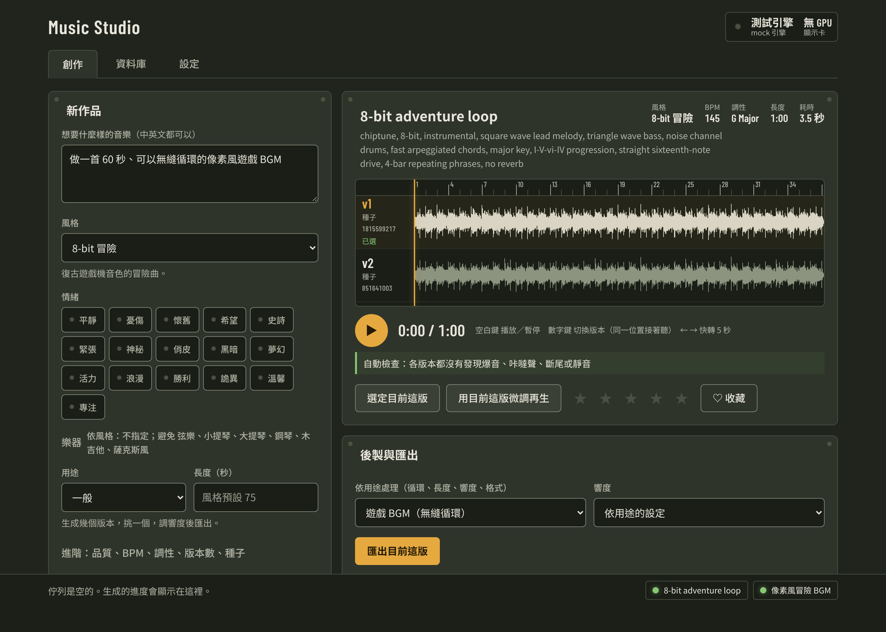

# music-studio

[繁體中文](README.md) | English

Generate instrumental music and BGM with [ACE-Step 1.5](https://github.com/ace-step/ACE-Step-1.5) on your own NVIDIA GPU: seamless game loops, video scores, study/work background music and personal tracks.

## Listen

All generated with ACE-Step 1.5 on an RTX 3050 Laptop 4 GB, with no manual editing or compression: only the excerpt was cut and its volume set by plain gain (about −14 to −16 LUFS).

**Pixel-style town, seamless loop**: `rpg-town`, 99 BPM, D major, 24 s, **loop version**: the loop seam is at 12 s. Caption: `fantasy rpg town theme, acoustic guitar, flute, light hand percussion, warm, cheerful, medieval folk, loopable`

VIDEO_URL_RPG_TOWN

**War requiem**: `war-requiem`, 64 BPM, D minor, 25 s cut from a 60 s track, not a loop. Caption: `epic sad orchestral, full string orchestra, solo cello lament, brass choir, deep timpani, slow military snare, adagio, tragic, film score`

VIDEO_URL_WAR_REQUIEM

**RPG battle with erhu and guzheng**: `rpg-battle`, 155 BPM, A minor, 25 s cut from a 50 s track, not a loop. Caption: `orchestral battle music, harmonic minor, i-bVI-bVII, syncopated accents, fast, ff, erhu, guzheng`

VIDEO_URL_RPG_BATTLE

**Study background piano**: `nature-piano`, 72 BPM, C major, 30 s cut from a 2-minute loop (no seam in this excerpt). Caption: `ambient solo soft felt piano, sparse gentle melody, simple repeating motif, warm nostalgic, peaceful, lots of space`

VIDEO_URL_NATURE_PIANO

The local dashboard (captured with the test engine, so the waveforms are not real music):



## Features

- **Styles and moods**: 17 built-in styles (8-bit adventure, lo-fi, quiet piano, RPG battle, war requiem…) and 16 moods; Chinese descriptions are turned into an English caption through a lexicon
- **Pick or avoid instruments**: each style suggests fitting instruments and avoids unfitting ones, and you can name your own, e.g. "erhu and guzheng, no drums" (3.4.0)
- **Automatic checks**: every generated variant is checked for clipping, clicks, a cut-off ending, long silences and low volume, with timestamps (3.3.0)
- **Loudness presets** on export: video −14, game −16, study/background −18 LUFS (3.3.0)
- **Seamless loops**: the game-BGM workflow builds the loop seam and a loop preview
- **Local dashboard**: audition, compare variants on one shared timeline, edit the caption, refine from a variant you like, export
- **Everything customisable**: defaults, styles, moods, lexicon and workflows live in your workspace, not in the skill folder

## Requirements

- **NVIDIA GPU**, tier picked automatically from VRAM: low < 6 GB, mid 6–12 GB, high 12–20 GB, ultra 20 GB+. Higher tiers get larger models, longer pieces and more variants per run
- Tested on an RTX 3050 Laptop 4 GB: a 60-second piece takes about 35–65 seconds
- **Windows**: only tested on Windows. There is no setup script for Linux or macOS
- First run: double-click `setup.bat` (runs `scripts/setup_windows.ps1`). It checks for and installs Python and ffmpeg, then downloads ACE-Step 1.5 and the models your GPU tier needs, asking before each install
- Workspace: `%USERPROFILE%\MusicStudio` (takes, settings, custom styles). Set `MUSIC_STUDIO_HOME` to move it
- ACE-Step is most stable at 30–180 seconds; for longer pieces, generate one section and loop it

## Install

Claude Code only:

```text
/plugin marketplace add PeanutGT/NutsSkills
/plugin install music-studio@nutsskills
```

There is no zip for Claude.ai: the music is generated on your computer's GPU, and Claude.ai's cloud sandbox has no GPU and cannot reach your machine. For auto-update, see the [install section of the main README](../../README.en.md#claude-code).

## Usage

After installing, just ask Claude, for example:

- "Make a 60-second pixel-art game BGM that loops seamlessly"
- "Make 3 minutes of study background music, quiet piano, no drums"

Claude checks the setup (and installs what is missing), writes the caption, generates, explains the automatic check results, then exports for your use case.

**Dashboard**: Claude starts it in the background and gives you the URL. You can also double-click `start_dashboard.bat` and open http://127.0.0.1:8765 . Jobs from Claude and from the dashboard share one queue, and the models stay loaded between runs.

## Files

- `SKILL.md` — the skill itself
- `scripts/` — generation engine, local server and job queue, post-processing (trim, loop, loudness, export), library and config tools
- `dashboard/` — the local dashboard web page
- `defaults/` — shipped defaults, styles, moods, lexicon and workflows (your own versions go in the workspace)
- `docs/ARCHITECTURE.md` — how the server, queue and ACE-Step worker fit together
- `references/` — caption writing, quality troubleshooting, config reference and more; Claude reads them as needed
- `setup.bat`, `start_dashboard.bat` — Windows setup and dashboard launcher
- `tests/`, `evals/` — test cases (for development)
- `CHANGELOG.md` — release notes (Traditional Chinese)

## Known limitations

- Instrumental only for now; vocals, sound effects and remixing existing audio are planned
- No exact cue points in time and no stems
- Automatic checks and loop-seam numbers are heuristics; your ears decide

## License

Apache-2.0. ACE-Step 1.5, its model weights, ffmpeg and other third-party models and tools are under their own licences; check the model licence before using generated music commercially.
