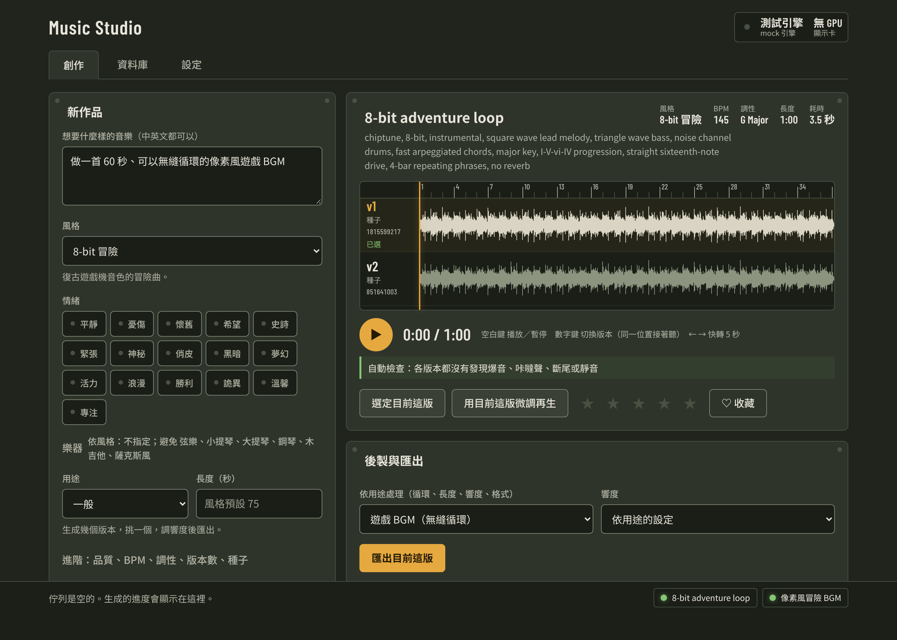

# music-studio

繁體中文 | [English](README.en.md)

在自己的 NVIDIA 顯卡上用 [ACE-Step 1.5](https://github.com/ace-step/ACE-Step-1.5) 生成純音樂／BGM：遊戲無縫循環、影片配樂、讀書工作背景音、個人創作。

## 試聽

全部由 ACE-Step 1.5 在 RTX 3050 Laptop 4 GB 上生成，沒有人工修音，只剪片段並把響度調到影片用的 −14 LUFS。

**像素風小鎮・無縫循環**：`rpg-town`，99 BPM D 大調，24 秒，**循環版**：第 12 秒就是循環接縫。caption：`fantasy rpg town theme, acoustic guitar, flute, light hand percussion, warm, cheerful, medieval folk, loopable`

VIDEO_URL_RPG_TOWN

**戰爭安魂曲**：`war-requiem`，64 BPM D 小調，從 60 秒的曲子剪 25 秒，非循環版。caption：`epic sad orchestral, full string orchestra, solo cello lament, brass choir, deep timpani, slow military snare, adagio, tragic, film score`

VIDEO_URL_WAR_REQUIEM

**RPG 戰鬥（指定二胡、古箏）**：`rpg-battle`，155 BPM A 小調，從 50 秒的曲子剪 25 秒，非循環版。caption：`orchestral battle music, harmonic minor, i-bVI-bVII, syncopated accents, fast, ff, erhu, guzheng`

VIDEO_URL_RPG_BATTLE

**讀書背景鋼琴**：`nature-piano`，72 BPM C 大調，從 2 分鐘的循環曲剪 30 秒（這段不含接縫）。caption：`ambient solo soft felt piano, sparse gentle melody, simple repeating motif, warm nostalgic, peaceful, lots of space`

VIDEO_URL_NATURE_PIANO

本機儀表板（用測試引擎產生的畫面，波形不是真的音樂）：



## 特色

- **風格庫與情緒**：內建 17 種風格（8-bit 冒險、Lo-fi、安靜鋼琴、RPG 戰鬥、戰爭安魂曲……）和 16 種情緒，中文描述會透過詞庫轉成英文 caption
- **指定或避開樂器**：每個風格有建議與要避開的樂器，也可以自己指定，例如「用二胡和古箏、不要鼓」（3.4.0）
- **自動品檢**：每次生成完自動檢查爆音、咔噠聲、結尾被切斷、中間長靜音、音量過小，附時間點（3.3.0）
- **響度預設**：匯出時可選影片 −14、遊戲 −16、讀書背景 −18 LUFS（3.3.0）
- **無縫循環**：遊戲 BGM 用途會做循環接縫並附循環試聽版
- **本機儀表板**：試聽、多個版本對齊在同一條時間軸比較、自己改 caption、以喜歡的版本微調再生、匯出
- **全部可自訂**：預設值、風格、情緒、詞庫、工作流程都放在你的工作資料夾，不動 skill 本身

## 需求

- **NVIDIA 顯卡**，依顯存自動分級：low < 6 GB、mid 6–12 GB、high 12–20 GB、ultra 20 GB 以上。等級越高，可用的模型、長度與一次生成的版本數越多
- 實測過 RTX 3050 Laptop 4 GB：60 秒的曲子約 35–65 秒
- **Windows**：目前只在 Windows 上測過。Linux／macOS 沒有安裝腳本
- 第一次使用雙擊 `setup.bat`（執行 `scripts/setup_windows.ps1`）：檢查並安裝 Python、ffmpeg，下載 ACE-Step 1.5 和你的顯卡等級需要的模型。每一步安裝前都會先問你
- 工作資料夾在 `%USERPROFILE%\MusicStudio`（作品、設定、自訂風格都在這裡），可以用環境變數 `MUSIC_STUDIO_HOME` 改位置
- ACE-Step 在 30–180 秒最穩定；更長的曲子先生成一段，再用循環延長

## 安裝

只支援 Claude Code：

```text
/plugin marketplace add PeanutGT/NutsSkills
/plugin install music-studio@nutsskills
```

沒有 Claude.ai 用的 zip：音樂要在你電腦的顯卡上生成，Claude.ai 的雲端執行環境沒有 GPU，也連不到你的電腦。自動更新的設定見 [repo 首頁的安裝說明](../../README.md#claude-code)。

## 使用方式

安裝後直接對 Claude 說，例如：

- 「做一首 60 秒、可以無縫循環的像素風遊戲 BGM」
- 「幫我做 3 分鐘的讀書背景音，安靜的鋼琴，不要鼓」

Claude 會先確認環境（缺什麼會幫你裝），寫好 caption、生成、說明自動檢查的結果，再依用途匯出。

**儀表板**：Claude 會在背景啟動並給你網址；也可以自己雙擊 `start_dashboard.bat`，瀏覽器打開 http://127.0.0.1:8765 。Claude 和儀表板送出的工作會在同一個佇列排隊，模型在兩次生成之間保持載入。

## 檔案

- `SKILL.md` — skill 本體
- `scripts/` — 生成引擎、本機伺服器與佇列、後製（剪輯、循環、響度、匯出）、作品庫、設定工具
- `dashboard/` — 本機儀表板網頁
- `defaults/` — 內建的預設值、風格、情緒、詞庫、工作流程（自訂的版本放在工作資料夾）
- `docs/ARCHITECTURE.md` — 伺服器、佇列與 ACE-Step 工作程序怎麼搭在一起
- `references/` — 撰寫 caption、品質問題排查、設定說明等，Claude 需要時才讀
- `setup.bat`、`start_dashboard.bat` — Windows 安裝與開啟儀表板
- `tests/`、`evals/` — 測試案例（開發用）
- `CHANGELOG.md` — 更新紀錄

## 已知限制

- 目前只有純音樂；人聲、音效、改編現有音訊還在規劃中
- 不能指定精確的時間點，也不能輸出分軌
- 自動品檢與循環接縫的數字是啟發式判斷，最後還是要用耳朵聽

## 授權

Apache-2.0。ACE-Step 1.5、模型權重、ffmpeg 等第三方模型與工具依各自的授權；商業使用生成的音樂前，請先確認模型的授權條款。
