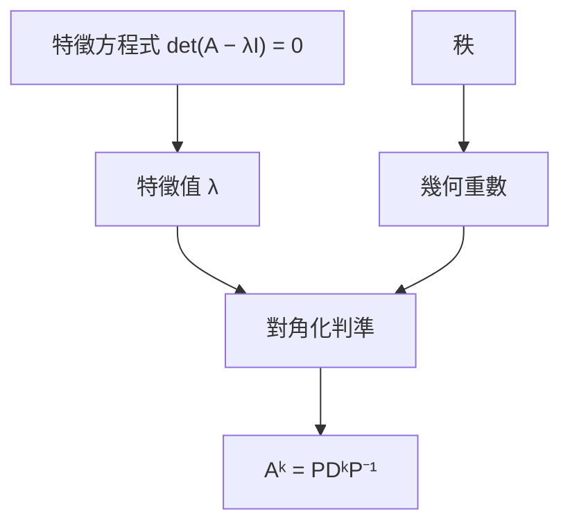

:::map 概念地圖

:::

## 元件

:::pattern 判斷能否對角化 | 考古題 4/4 年 | 必考 | ★★☆
#### 🧭 SOP
1. 求特徵值 {{前置: 特徵方程式}}
2. 有重根 λ → 算 $n-\operatorname{rank}(A-\lambda I)$

:::warn 陷阱
可逆 ≠ 可對角化
:::
:::

:::fig Binomial(10, 0.3)

:::

:::cornell 基本觀念
:::cue 特徵向量可以是零向量嗎？
不行，$A\mathbf 0=\lambda\mathbf 0$ 對任何 λ 都成立。
:::
:::recap
對角化＝找到 n 個獨立的「只伸縮」方向。
:::
:::

:::layer 1
- **對角化**：$A=PDP^{-1}$
:::

$$\det\begin{pmatrix}2-\lambda&1\\1&2-\lambda\end{pmatrix}=(\lambda-1)(\lambda-3)$$

:::q 1 | 計算題 | ★☆☆ | space=3
求 $A=\begin{pmatrix}2&1\\1&2\end{pmatrix}$ 的特徵值。

> Find the eigenvalues of $A$.
:::

:::a 1 | ✓ 已驗算
$\lambda=1,3$
:::
